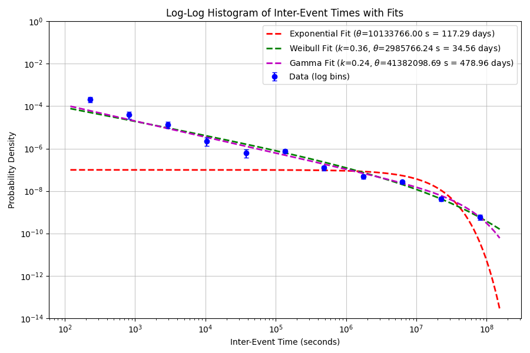
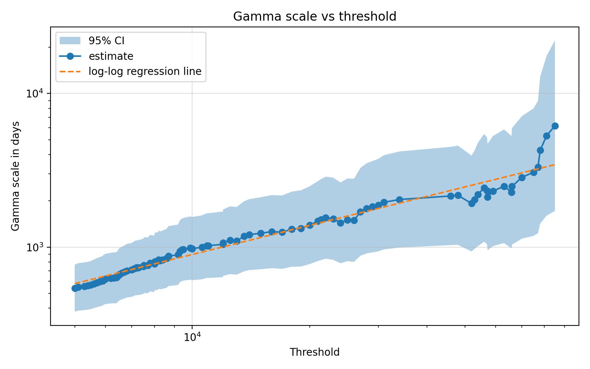
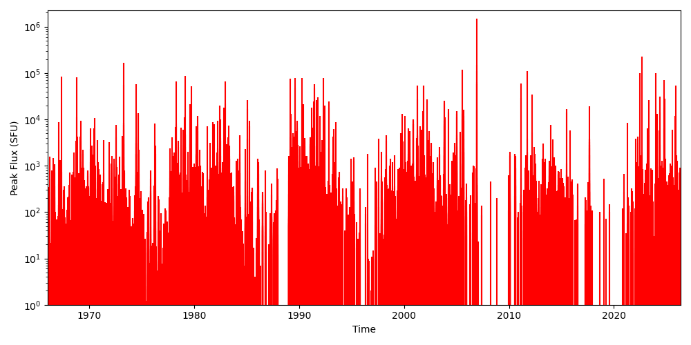

# Forecasting extreme solar radio bursts from inter-event times

Statistical analysis of the time between consecutive solar radio bursts above
a peak-flux threshold, and how it changes with the threshold. The final goal
is to estimate the probability of an extreme burst (≥ 10⁶ SFU) within the
next 10 years.

This repository contains the code of my BSc thesis in Mathematics
(Universitat Autònoma de Barcelona, 2026, advisor: Dr. Víctor Navas):
*Statistical Modelling of Inter-Event Times for Extreme Event Forecasting*.

## Main results

* **A Poisson process is too restrictive.** The exponential distribution of
  waiting times, which corresponds to a homogeneous Poisson process, does not
  fit the data. Weibull and Gamma models fit much better, and the Gamma model
  gives the best fit among the candidates.
* **The Gamma scale grows as a power law of the threshold**, so a single
  regression model, scale(T) = b0 · T^b1, describes all thresholds and can be
  extrapolated to extreme events.
* **Forecast.** Given the time elapsed since the December 2006 event, the
  conditional probability of at least one burst above 10⁶ SFU in the next
  ten years is **(18.8 ± 3.4) %** (bootstrap uncertainty, value reported in the
  thesis). The estimate is limited by the scarcity of extreme events and by
  possible instrumental saturation.

<p align="center">
  
  
</p>

*Left: inter-event time distribution with the three fitted models; the
exponential fails over most of the range. Right: Gamma scale against
threshold, with 95 % confidence intervals and the log-log regression used for
the forecast.*

## Data

Solar radio burst catalogue from NOAA, recorded by the Radio Solar Telescope
Network (RSTN) at 1415 MHz, a frequency relevant to GNSS reception and timing
systems. Waiting times of 119 s or less are discarded (see `srb/config.py`).

<p align="center">
  
</p>

## Questions

The project answers four questions, in order:

1. **Are the waiting times independent?** (autocorrelation)
2. **Which distribution describes them?** Exponential (Poisson process),
   Weibull or Gamma (AIC and Lilliefors / Kolmogorov–Smirnov test)
3. **How do the distribution parameters depend on the threshold?** Is the
   shape constant? (per-threshold fits with confidence intervals, Wald test)
4. **What is the probability of an extreme burst?** One model for all
   thresholds, with scale(T) = b0 · T^b1, extrapolated to 10⁶ SFU, with
   bootstrap uncertainties.

## Repository structure

```
├── data/
│   └── srb_notST4_2010_df.txt     # burst catalogue (time, station, peak flux, spectral type)
├── notebooks/                     # the analysis, step by step (read in order)
│   ├── 01_concepts_synthetic_examples.ipynb
│   ├── 02_data_exploration.ipynb
│   ├── 03_autocorrelation.ipynb
│   ├── 04_parameters_vs_threshold.ipynb
│   ├── 05_constant_shape_wald_test.ipynb
│   ├── 06_goodness_of_fit_per_threshold.ipynb
│   └── 07_threshold_regression_and_forecasting.ipynb
├── srb/                           # reusable code imported by the notebooks
│   ├── config.py                  # shared settings (paths, 119 s rule, threshold grid, seed)
│   ├── data.py                    # load catalogue → waiting times per threshold
│   ├── distributions.py           # Exponential, Weibull, Gamma (pdf, cdf, survival, sampling)
│   ├── fitting.py                 # maximum likelihood: per threshold and across thresholds
│   ├── diagnostics.py             # autocorrelation, Lilliefors test, bootstrap summaries
│   ├── wald.py                    # Wald test for a constant shape
│   ├── forecasting.py             # probability of an extreme burst within a horizon
│   └── plotting.py                # figures
├── results/
│   ├── figures/                   # figures saved by the notebooks
│   └── tables/                    # CSV tables saved by the notebooks
└── requirements.txt
```

**Notebooks** explain *what* is done and *why*, and show the results.
**`srb/`** contains *how* it is done: every formula lives in exactly one place,
with a docstring explaining it.

## Pipeline

```
catalogue ──► bursts with peak flux ≥ T ──► waiting times (gaps ≤ 119 s dropped)
                                                   │
          ┌────────────────────┬───────────────────┼──────────────────────┐
          ▼                    ▼                   ▼                      ▼
    03 autocorrelation   06 fit per threshold   04 parameters vs T    07 joint model
                         AIC + Lilliefors       05 Wald test (shape)   scale(T) = b0·T^b1
                                                                           │
                                                                           ▼
                                                              P(burst ≥ 10⁶ SFU in 10 years)
```

## Getting started

```bash
git clone https://github.com/marc-flores-catlla/extreme-event-forecasting.git
cd extreme-event-forecasting
pip install -r requirements.txt
jupyter lab notebooks/
```

The notebooks add the repository root to the Python path in their first cell,
so `srb` can be imported without installing anything else.

Notebooks 05, 06 and 07 run 10 000 bootstrap / Monte-Carlo repetitions and
take several minutes. Lower `N_BOOTSTRAP`, `LILLIEFORS_REPEATS` or
`BOOTSTRAP_REPEATS` in their *Parameters* cell for a quick run.

## Configuration

* Settings shared by every analysis are in [`srb/config.py`](srb/config.py):
  data file, minimum separation between events (119 s), minimum number of
  waiting times per threshold (10), default threshold grid (20 log-spaced
  values in [10³, 10⁵] SFU) and random seed.
* Settings specific to one analysis (threshold range, number of repetitions,
  forecast threshold and horizon, …) are in the *Parameters* cell at the top
  of each notebook.

## Extending the project

* **New distribution** (e.g. log-normal): define its `logpdf`, `cdf`, `sf` and
  `sample` in [`srb/distributions.py`](srb/distributions.py), following the
  convention that the scale is the last parameter, and add it to
  `DISTRIBUTIONS`. Fitting, testing, regression across thresholds and
  forecasting work with it without further changes; just add it to the
  `MODELS` list of a notebook.
* **New dataset**: change `DATA_FILE` in `srb/config.py` (or pass a path to
  `load_catalogue`). The file must have the same five columns.
* **New analysis**: add a notebook that starts from
  `load_catalogue()` → `inter_event_times_by_threshold()` and reuses the
  functions in `srb/`.

## Notes

* **The forecast depends on the date it is run.** The conditional
  probability uses the time elapsed since the last burst ≥ 10⁶ SFU in the
  catalogue up to `FORECAST_START_TIME` (today by default).
* **Bootstrap of the Wald test.** Resampling catalogue rows with replacement
  keeps on average ~63 % of the distinct bursts (repeated bursts produce
  zero-length gaps, which the 119 s rule removes). The highest thresholds then
  often have fewer than 10 waiting times and the whole bootstrap sample is
  discarded, so only a small fraction of the 10 000 samples is used. The
  notebook prints how many.
